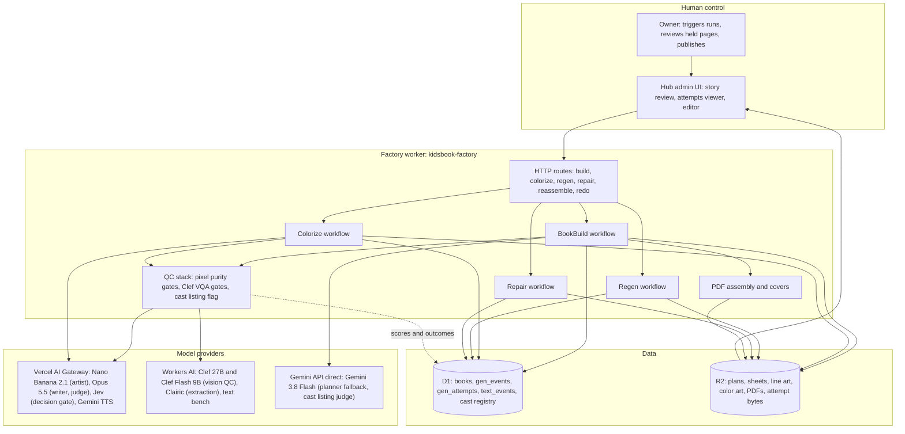
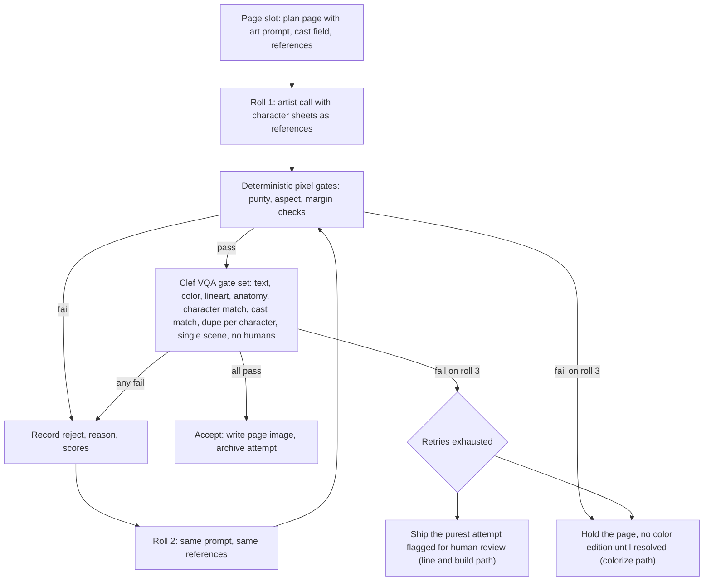

# Big Brain Shelf Book Factory: Issue and Architecture Report

**Prepared:** 2026-11-01
**Purpose:** External architecture and cost review. The owner is handing this document to several frontier models (GPT, Gemini, Claude Opus) and asking each the same questions: what is working, what is failing, and what should change so that a finished book costs $5 to $6 to produce instead of $8 to $11.
**Scope:** The book production factory only. The bookstore (storefront, checkout, accounts, clubs) is a separate system, is considered healthy, and is out of scope except where it consumes factory output.

## How to use this document (paste ready prompt)

> You are reviewing the production architecture of an AI childrens book factory. Read the whole report first. Then answer the numbered questions in Section 11, in order. Ground every recommendation in the measured evidence in Sections 6 and 7; say clearly when you are reasoning from general practice instead. Prefer changes that raise first attempt acceptance over changes that add more review. Respect three fixed constraints: (1) a page that fails its gates is never shipped silently, it is held for a human; (2) the factory runs on Cloudflare Workers, Workflows, D1, and R2, and a platform rewrite is not on the table; (3) books are original stories for ages 4 to 8, no humans appear in the art, and characters are animals with registered character sheets. End with the three changes you would make first, in order, with the saving you expect from each and how you would prove it.

## Where we are and what we are building

**Where we are.** Big Brain Shelf is a one person company (plus AI agents) in Searcy, Arkansas, selling original childrens picture books through its own store. Nine books are in the catalog pipeline; one is finished and selling. The store works. The factory works, at $8 to $11 per finished book against a sell price of $8.99 for the digital bundle and $20 printed, which means production cost is currently the whole business problem. Everything runs on Cloudflare (Workers, Workflows, D1, R2, Workers AI) plus one model gateway. There is no team of engineers, no platform department, and no appetite for a rewrite: whatever is proposed must be operable by one founder and his agents.

**What we want to be.** The stated ambition, in the owners words, is to build the next Fortune 500 company in childrens media: "the next Disney or Pixar." Concretely, that means a factory that produces a growing catalog of original, multi language, multi format books (print, digital, audio, read along video) at a unit cost that leaves real margin, with quality that survives a parents trust. The catalog plan already includes three age bands (4 to 8 now, 9 to 13 and 14 to 18 next), four day one languages (English, Spanish, Portuguese, French) with three more built dark (German, Italian, Dutch), subscription clubs that ship printed boxes quarterly, and full cast audiobooks as a standard, not a luxury. None of that scales at $9 to $11 of variable cost per book with 20 to 35% first roll yield. All of it is plausible at $5 to $6 per book with boring, measured, compounding reliability. That is the actual goal of this review: not a cheaper demo, a production system whose economics let a catalog exist.

**Resources and constraints a reviewer should know.**

- Cloudflare is the home platform and the owner has Cloudflare credits and a standing instruction to use any Cloudflare service that helps.
- Approximately **$500 in AWS credits** exist, but they **cannot currently be spent on non Amazon AI model calls** (Claude on Bedrock requires an AWS sales process the owner has not run). They are available for non model infrastructure if the architecture earns it: GPU compute experiments (for example a self hosted image model test), storage, queues, rendering, or an analytics warehouse. Spending them is a tradeoff against holding them for a future Bedrock arrangement.
- Human review time is the scarcest resource. Any proposal that trades machine cost for large amounts of founder review time is a bad trade at catalog scale, even if the dollar math looks better.
- The owner approves spend in small, verified steps: pilot first, measure, then scale. Proposals should assume canary sized rollouts, not big bang migrations.

**An admission that shapes this whole report: we ran the factory without storing what it produced, and those results are gone.** For most of the factory's life, every rejected image roll was discarded the moment it failed. Gate scores existed only in ephemeral worker logs. Metering of any kind began on 2026-10-26; the attempt archive (every roll's bytes, scores, and reject reason, kept) began on 2026-11-01, the same day this report was written. The consequence is measurable: lifetime model gateway spend is $106.86, and only $48.43 of it can be attributed to a book, a stage, or a call type. The rest bought lessons we can no longer inspect. Hundreds of October rolls that could have taught us the failure patterns in Section 7, months earlier and at no extra cost, no longer exist. This is stated plainly because it is now policy, in the owner's words: "act like we are at Meta scale; they would have kept the data." Storage is cheap; unkept data is unrecoverable. Going forward the archive is treated as a strategic asset, not exhaust: it is the eval set for every gate change, the ground truth for judge bake-offs, the training corpus if a specialist model is ever fine tuned, and the defect knowledge base the judges learn from. Reviewers should treat any proposal that discards paid outputs, scores, or reasons as disqualified on that ground alone, and should assume we intend to exploit this data asset aggressively, because it is the one input that compounds.

## 1. Executive summary

The factory turns a source curriculum text into a finished, sellable childrens book: an original story bible, chapter plans, black and white line art for every page, a full color edition of the same pages, composed covers, print ready PDFs, and a full cast audiobook. It works. Nine books exist in the catalog; one is fully finished and on sale. The problem is unit economics and the variance around them.

Measured facts, all sourced in Section 6:

- Image generation is metered at 837 events and $46.62 across 9 books since metering began on 2026-10-26. Lifetime spend at the model gateway is $106.86, so **less than half of all spend is attributable** to a book, a stage, or a call type. That attribution gap is itself a top finding.
- The image artist charges about **$0.06 per roll**. A standard book has 40 interior pages plus 8 chapter finale illustrations. Cost is therefore almost entirely a function of **rolls per accepted page**, which is a function of gate behavior, prompt and reference quality, and retry policy.
- Clean first roll acceptance is low: attempt 1 inside a generation call accepts **52.2% on line art and 34.6% on colorize**. Across all paid rolls in the metered window, only **35.7% of line rolls** and **19.9% of colorize rolls** were accepted clean; the rest were rejected (52.4% line, 67.1% colorize) or shipped flagged after exhausting retries.
- **Colorize is the most expensive stage per page.** One book, Mira, burned 186 metered colorize events and $9.39 across three runs before reaching 35 of 40 pages colored. The first run alone cost $5.39 and held 19 of 40 pages, for reasons that turned out to be factory bugs, not artist quality (Section 7, F1).
- The third roll is nearly waste: attempt 3 acceptance is **under 11%** on both surfaces, yet the pipeline buys it by default. Metered attempt 3 spend is $5.54 (line) and $4.93 (colorize) in a $46.62 window.
- The text side is comparatively healthy. A whole book read pass, run before any art spend, parked a defective book for about **$0.20** and caught defects that would have cost dollars in re rolls downstream. The image side has no equivalent cheap, whole artifact gate.

The owners cost ruling (2026-11-01): **$5 to $6 per finished book is acceptable; $8 to $10 is not.** The gap between current cost and target is not the price of a roll. It is yield. Section 9 shows the arithmetic: at $0.06 per roll, the target is reachable only if combined rolls per finished page across both surfaces fall to roughly 1.6 to 1.9, or if the color surface gets structurally cheaper (fewer, cheaper, or batched rolls).

## 2. Product context

- Big Brain Shelf sells original picture books that teach real concepts (mastery, saving, algorithms, design patterns, the compound effect) to children ages 4 to 8, through animal characters. Each book has a small fixed cast (usually three characters) with registered character reference sheets.
- A sellable book consists of: story text (introduction, 8 chapters, an ending), one line art illustration per story page (40 pages) plus one finale illustration per chapter (8), a full color version of every line page, a composed color front and back cover, a coloring book PDF, a picture book PDF, and a full cast audiobook (a separate local pipeline, Section 4.3).
- Production runs through the factorys own admin flow. The factory holds bad pages instead of shipping them; a human reviews held pages. One book is produced at a time.
- Nine books are in the pipeline at various stages. One (Mira) is complete and selling. The rest wait on art fixes, casting, or review.

## 3. Architecture today

### 3.1 Components

| Component | Technology | Job |
| --- | --- | --- |
| Factory worker `kidsbook-factory` | Cloudflare Worker (TypeScript, single bundled script, about 15 source modules) | All production HTTP routes and workflow classes |
| BookBuild workflow | Cloudflare Workflows | Full book build: extract, split, book info, bible, plan, read pass, images, assemble, register |
| Colorize workflow | Cloudflare Workflows | Colors every line page of a finished base book; separate, human triggered process |
| Regen workflow | Cloudflare Workflows | Replans and redraws selected chapters |
| Repair workflow | Cloudflare Workflows | Audits a whole book, repairs defects in dependency order, re audits |
| Reassemble workflow | Cloudflare Workflows | Rebuilds PDFs from current page artifacts |
| Bookstore hub | Astro on Cloudflare Workers (separate repo and worker) | Storefront plus the admin UI: book list, story review, attempts viewer, editor |
| D1 database `kidsbook-hub` | SQLite at the edge, shared by factory and hub | Book state, stage tracking, metering tables, cast registry, review notes |
| R2 bucket `kidsbook-factory` | Object storage | Source PDFs, bibles, plans, page images (line and color), character sheets, PDFs, audiobook files, attempt archive (new) |
| Vercel AI Gateway | Model gateway | Paid access to the image artist, the writer and judge models, the decision model, and TTS voices; balance and lifetime spend live here |
| Workers AI | Cloudflare AI binding | The vision QC judges (Clef family), document extraction (Clairic), and a bench of fallback text models |

### 3.2 System diagram

### 3.3 The base build pipeline

```mermaid
flowchart LR
    A["1. Extract: source PDF text (unpdf, Clairic headings and extraction)"] --> B["2. Split into chapters"]
    B --> C["3. Book info: title, topic, age band"]
    C --> D["4. Bible: cast, world rules, visual descriptions, forbidden terms"]
    D --> E["5. Plan: per chapter pages with story text, art prompt, cast, concept"]
    E --> F["5b. Read pass: whole book text gate, verdict pass or revise, about $0.20"]
    F -->|revise| STOP1["Park at needs_review, zero art spend"]
    F -->|pass| G["6. Character sheets, then pose crops"]
    G --> H["7. Images: per page generation with QC loop, pilot gate after chapter 1"]
    H --> I["8. Assemble: picture book PDF, coloring book PDF, covers"]
    I --> J["9. Register: editor chapters, status ready_for_qa"]
    J --> K["Human QA and publish"]
    K -. separate button .-> L["Colorize workflow: color edition"]
    K -. separate button .-> M["Tier processes and audiobook"]
```

Key structural facts:

- The base book is line art only. Color is a separate, later, separately budgeted process run against the books own line drawings. This separation is deliberate and the owner wants it kept, with separate budgets.
- The **pilot gate** stops a fresh build after chapter 1 art for a visual check before the remaining chapters spend.
- The **read pass** (step 5b) judges the whole books text before any art spend: four blocking checks and five warning checks, with quoted evidence, and the verdict recomputed in code so a lenient model cannot override a failed block. A content fingerprint prevents paying twice for unchanged text.
- A per run spend cap (default $10 of metered image spend) holds further pages when reached. Caps are per workflow run, which matters for failure F8: starting a new run resets the effective budget.

### 3.4 The per page generation and QC loop

Every image surface (line, picture color, colorize) runs the same shape of loop, implemented separately in three modules. This duplication is one of the architectural findings.

Behavior differs by surface in one important way: the build path ships its best attempt **flagged** after three failed rolls (the page exists, a human must look), while colorize **holds** the page (no color file, and the color PDF cannot assemble until every page resolves). Both behaviors have produced cost and quality incidents; see F7.

Colorize prompt, verbatim, because reviewers should judge it: "Colorize the first image: a black-and-white line drawing from a childrens picture book. Keep every line, character, pose, and object exactly where it is. Only add rich, warm watercolor color inside the existing lines, matching the character reference sheets when they are provided. Do not add, remove, move, or redraw anything. No text, no letters, no words, no numbers anywhere in the image." The line page is the first reference; character sheets follow.

## 4. The players: every AI model and what it does

### 4.1 Model roster

| Model | Access | Role in the factory | Unit economics | Evidence and known behavior |
| --- | --- | --- | --- | --- |
| **Gemini Nano Banana 2.1** (`google/gemini-nano-banana-2.1`) | Vercel AI Gateway | **The artist.** All image surfaces since 2026-10-23: line art, picture color, colorize, covers, character sheets. Receives the art prompt plus up to 3 character sheet references (and the line page first, for colorize) | About **$0.06 per roll** metered blended; Google list price $0.034 per 1K image, $0.050 per 2K; a Batch API at half price exists | Strong character consistency when given the right sheets. Fails in characteristic ways: hand shaped feet and hands growing off wings on birds, extra copies of a character, painting a co star to look like the lead when the lead sheet dominates the references. Quality is rarely the binding constraint; the gates and the references are |
| **Claude Opus 5.5** (`anthropic/claude-opus-5.5`) | Vercel AI Gateway | **Writer and judge.** Bible, planner drafts, book info (first in the writer chain). Chapter critic (first in the judge chain since 2026-10-28) plus a separate acceptance look per passed chapter. Also the read pass judge | About $0.10 per chapter drafted; read pass about $0.20 per book (9 metered calls, $1.76 total across books) | Chosen by head to head test: the only writer that produced a real chapter on the first attempt, twice. As critic it files a superset of the defects cheaper judges find; the defects a cheaper judge waved through (a computer drawn in an animal harbor) cost more in art re rolls than the judging saved |
| **Gemini 3.8 Flash** (`gemini-3.8-flash`) | Gemini API direct and gateway | **Planner fallback and cast listing judge.** Second in the writer chain. Also produces the cast listing (a structured count of animals per species in a finished image) used by the cast listing gate | Cheap per call; mostly unmetered today (F8) | Two operational traps found and fixed: it spends about 1,400 thinking tokens by default, which starved small output budgets and returned non JSON until `thinkingBudget: 0` was set for mechanical tasks. Its cast listings are good but not exact: counts drift on busy pages and background animals (Section 5.3) |
| **Clef 27B** (`@cf/cloudflare/clef`) | Workers AI | **Primary vision QC judge.** Answers a fixed set of yes/no propositions ("noul" questions) about an image with a reference sheet attached, each scored 0 to 1: text presence, color presence, line art purity, anatomy, character match, cast match, per character duplicate, single scene, no humans | Billed in Workers AI neurons on account credits, not gateway dollars; effectively cheap per call, but every roll pays at least one Clef call and rejects pay more | Deterministic per image bytes, which makes offline replay and calibration possible. Its scores are **not calibrated probabilities**: the anatomy proposition coin flips clean art (Section 5.2), and the duplicate proposition counts reflections and lookalike co stars. It is a useful instrument being read as an oracle |
| **Clef Flash 9B** (`@cf/cloudflare/clef-flash`) | Workers AI | **QC fallback** when Clef 27B errors or is unavailable | Cheaper and faster than the 27B | Fallback status is not always surfaced in results, so a page can be judged by a different instrument than its siblings without the record saying so (F8) |
| **Jev 1.14** (`typesafe-ai/jev-1.14.0`) | Vercel AI Gateway | **Decision model gate** used by the planner (plan structure decisions in `planv3.ts` via `gatewayDecide`) | Per decision pricing at the gateway; unmetered in D1 today | Not a chat model; a scored decision API. Included here because it is a gate whose calls and costs are invisible in current metering |
| **Clairic** (`@cf/cloudflare/clairic`) | Workers AI | **Document extraction**: chapter headings and structured extraction from source PDFs at build step 1 | Workers AI neurons | Quiet and reliable in its lane; no recorded incidents |
| **DeepSeek R1 Distill Qwen 32B, DeepSeek V4 Flash, Gemma 4 26B** | Workers AI | **Text bench**: tail of the writer chain when Opus and Gemini are unavailable | Workers AI neurons | Response shapes disagree per model; the chain normalizes them. Bench models have repeatedly needed generous token budgets because reasoning consumes the output budget (GLM 5.3 returned reasoning only chapter drafts, 0 for 2, and was removed from the judge chain for filing only a subset of defects) |
| **GLM 5.3** (`@cf/zai-org/glm-5.3`) | Workers AI | Removed from default chains; callable by env override | Workers AI neurons | Verdicts agreed with Opus on every major defect in the head to head but filed only a subset; hidden reasoning also starved fixed token budgets (a 2,000 token plan call produced reasoning only all day until the budget was raised to 4,000). `thinking: disabled` does not disable its thinking |
| **Gemini TTS voices** (Kore, Sadaltager, Fenrir, Puck, and others) | Vercel AI Gateway, driven by a local script, not the worker | **Audiobook cast.** Narration in the protagonists cast voice, each characters lines in their own voice, after a script splitter attributes every quote | Mira full cast: 131 segments, **$0.21 total**, 19:07 runtime | The cheapest, best behaved stage in the whole system. Casting is exclusive per character across books and recorded in a registry |

### 4.2 Retired players

- **FLUX 2 Klein 4B** (Workers AI) was the original line artist. Retired 2026-10-23 for Nano Banana 2.1: roughly 340 Elo below it on public image rankings, and the gateway artist follows character sheets far better.
- **LLaVA** was the old QC fallback. Removed entirely: it waved through tiny text scribbles that the product cannot ship.

### 4.3 Adjacent pipelines (context, not the cost problem)

- **Audiobooks** run locally: script splitting and speaker attribution, Gemini TTS per segment, loudness normalization, chapter markers, M4B assembly. A full book costs about $0.21 in voices. No change requested.
- **Video promos** run locally in HyperFrames with a single settled narrator voice. Out of scope for this review.
- **The hub admin** is the human surface: story review with the audiobook player pinned, per page defect notes, and (new, 2026-11-01) an attempts viewer showing every archived roll with its scores and reject reason.

## 5. The QC gate stack, gate by gate

A roll must pass deterministic pixel gates first, then the Clef VQA set, then (in flag mode) the cast listing check. Thresholds below are the production values as of 2026-11-01.

### 5.1 Deterministic pixel gates

| Gate | Rule | Behavior |
| --- | --- | --- |
| Purity | Fraction of pixels that are neither near black nor near white must stay under the books `line_purity` policy | Rejects shading, gray fills, and color in line art. Can auto fix some impure pages (contrast snap) instead of rejecting; autofixed pages count as accepted with a note |
| Aspect and margins | Output must match the expected portrait aspect and white margin profile | Rejects cropped or covered scenes, a hard product rule |
| Text and structure checks on plans | Forbidden term scan, trigram overlap against source, banned openers, hook chaining | Text side, deterministic, cheap, no recorded false positive incidents |

These gates are the healthiest part of the stack: deterministic, free, and replayable.

### 5.2 Clef VQA gates

| Proposition | Line bar | Color bar | Measured behavior |
| --- | --- | --- | --- |
| has_text (must be low) | 0.12 | 0.12 | Reliable. Scored 0.901 on a page with drawn sound effect words; near 0.01 to 0.03 on clean pages |
| has_color / is_color | at most 0.3 / n.a. | at least 0.5 | Reliable |
| is_lineart | at least 0.4 | n.a. | Reliable |
| character_match (vs sheet) | at least 0.5 | at least 0.5 | Useful. Drift failures in colorize cluster at 0.27 to 0.41 for a genuinely off model co star |
| cast_match (expected cast present) | at least 0.5 | at least 0.5 | **Question is ambiguous in practice**: a solo portrait of the lead scored 0.91 on a two character page, because the named character is indeed present. It verifies presence, not completeness |
| dupe_i per expected character (appears at most once) | at least 0.5 | at least 0.5 | **The noisiest gate in the system.** Counts reflections as second appearances until an exclusion clause was added to the question. On same species pairs (two herons), scores of 0.07 to 0.40 occur on art a human verifies as correct, because two similar birds read as the same character twice |
| single_scene | at least 0.5 | at least 0.5 | Scores 0.14 to 0.32 on some legitimate single scenes that resemble a pose sheet layout |
| no_humans | at least 0.5 | at least 0.5 | Reliable, scores 0.93 to 0.95 on clean pages |
| anatomy | at least 0.5 | **at least 0.3** (lowered 2026-11-01) | See below |

**Anatomy, the measured distribution.** From an 11 page probe census of verified art (2026-11-01): clean color pages score **0.316 to 0.564**; genuinely broken anatomy (a hand growing off a wing, hand shaped feet) scores **0.144**. At the old 0.5 color bar, most clean pages failed; the bar was lowered to 0.3 for the color path only. The line path still uses 0.5, and on 2026-11-01 it rejected **all 18 repair redraw rolls** across two pages (scores 0.10 to 0.48), including rolls whose other gates passed above 0.85. Whether those rolls were good art is partially verified: the two latest attempts, read by a human, were on brief but simplified scenes (see F5), and their feet were normal.

### 5.3 Cast listing gate (flag mode)

A Gemini Flash listing counts animals per species in the finished image; code compares the listing to the expected cast. Calibration on a 33 page human verified corpus (12 real defects, 21 clean): **precision 0.69, recall 0.92, false rejects 5 of 21 clean pages (24%)**, concentrated in background flocks, background ducklings, and busy multi species pages. Decision: the gate **flags** pages for human review and never rejects on its own. As a hard gate it would burn paid re rolls on roughly one in four good pages. Revisit only with a listing method that separates named cast from background animals of the same species.

## 6. Metrics: what we collect and what it says

### 6.1 What exists

| Source | Coverage | Contents |
| --- | --- | --- |
| D1 `gen_events` | Image calls, from 2026-10-26 | One row per paid image call: book, kind (line, colorize, cover), chapter, page, attempt within the call, outcome, cost. 837 rows, $46.62, 9 books |
| D1 `gen_attempts` | From 2026-11-01 only | One row per roll in the main loops **plus the image bytes in R2**, all gate scores, the deciding reject reason, cost. 52 rows, $3.20, all from the Mira fix day. This is the archive the owner ordered ("act like we are at Meta scale: keep the data"); before it, rejected rolls were discarded and only counts survived |
| D1 `text_events` | Partial | One row per metered text call: model, purpose, tokens, cost. Only 14 rows, $1.81. The read pass and repair escalation are metered; most planner, writer, and judge traffic is not |
| Gateway account | Lifetime | Balance and lifetime spend: **$106.86 total used** as of 2026-11-01. No per call detail |
| Workers Logs | Days of retention | Console logs per invocation, queryable through the Cloudflare observability telemetry API (verified live 2026-11-01). Useful for debugging, never an archive |
| Human records | Ad hoc | Calibration corpus for the cast listing gate (33 pages), a cast audit of shipped pages, probe replays of held pages |

### 6.2 Outcome table, metered image calls (2026-10-26 to 2026-11-01)

| Surface | Paid rolls | Clean accept | Shipped flagged | QC reject | Other | Metered cost | Clean accept rate per paid roll |
| --- | --- | --- | --- | --- | --- | --- | --- |
| Line | 454 | 162 | 51 | 238 | 3 purity reject | $27.25 | 35.7% |
| Colorize | 301 | 60 | 39 | 202 | 2 gateway errors among unpriced rows | $18.75 | 19.9% |
| Cover | 9 | 1 | 2 | 6 | 5 gateway errors among unpriced rows | $0.61 | n.a. (tiny sample) |
| **Total** | **764 paid rolls** | | | | 837 events including unpriced held rows | **$46.62** | |

Held rows (66 across surfaces) carry no cost in `gen_events` because the cost is booked on the rolls that produced them.

### 6.3 Yield by attempt number

"Attempt" is the roll number inside one generation call. Repair or regen can call the function again and reset the count, so these are operational proxies, not unique page rates.

| Surface | Attempt 1 accept | Attempt 3 accept | Attempt 3 metered spend |
| --- | --- | --- | --- |
| Line | 52.2% | under 11% | $5.54 |
| Colorize | 34.6% | under 11% | $4.93 |

Reading: the first roll is the product. The second roll is insurance. The third roll, bought by default today, converts at under 11% and consumed about **$10.47 of the $46.62** metered window.

### 6.4 The Mira colorize case, in full

Mira is the only book taken through colorize end to end, so she is the cost case study.

| Run | When | Result | Metered cost | What actually went wrong |
| --- | --- | --- | --- | --- |
| Run 1 | 2026-11-01 13:47 | 21 colored, **19 held** | $5.39 (104 events) | QC cast built from the plan character field alone: one name on two character pages, so the dupe questions fired on the lead while a co star stood in frame; the finale caller demanded every bible character on every finale. Factory bug, not artist quality (F1) |
| Run 2 | 2026-11-01 ~14:25 | 28 of 40 colored, 12 held | $2.72 | Cast fix deployed (prompt names added). Remaining holds split between anatomy gate noise and cast blindness through embedded visual descriptions (F1, second mechanism) |
| Probe census | 2026-11-01 afternoon | 11 held pages replayed offline | $0.66 | 4 pages were anatomy noise on verified clean art; only 2 of the 12 holds were true drawing defects in the October line art (hand feet, hand wing) |
| Fix round | 2026-11-01 ~15:15 to 15:45 | Repair redrew 0 of 2 defective pages (18 rolls, all rejected by line gates, $1.08 in the archive); colorize run 3 colored 7 more pages | Fix round total $2.63 by gateway balance delta | Anatomy bar lowered to 0.3 on the color path; `castForPage` shipped: cast resolved from scene cast, field and prompt names, **or the bible visual text embedded in the prompt**, driving both QC cast and reference sheets |
| **Final state** | 2026-11-01 15:45 | **35 of 40 colored, all 8 finales done** | **Mira colorize total: 186 events, $9.39** | Missing: S3p0 (true hand feet inherited from line art), S2p2 and S4p2 (co star drift, character_match 0.27 to 0.41), S7p0 (dupe counter 0.09 to 0.25 on a sleeping character scene), S5p3 (held with no attempt recorded, F8) |

Mira all in for the day: about **$11.90 of a $12 top up** (colorize $9.39 metered across all runs and earlier tests, probes $0.73, audiobook $0.21, repair rolls, balance rounding), plus about $0.20 for another books read pass. The gateway balance ended at **-$0.16**.

### 6.5 What the metrics cannot say (measurement caveats)

- Metering began 2026-10-26 for images and is partial for text; the attempt archive began 2026-11-01. October builds before metering are unrecoverable except as lifetime gateway spend.
- $106.86 lifetime gateway spend minus $48.43 D1 attributed (images $46.62 plus text $1.81) means **about 55% of spend cannot be assigned** to a book, stage, or model. Text calls, Jev decisions, cast listings, Clef fallbacks, and several gateway helpers are unmetered or partially metered.
- Workers AI costs (Clef judging on every roll, Clairic, the text bench) bill as account neurons and appear **nowhere** in the per book ledger.
- `gen_events` attempt numbers reset per generation call; cross call page yield must be reconstructed from the archive, which only exists for one day so far.

## 7. Failure catalog

Each failure lists its mechanism, its measured footprint, and its current status. IDs are used in the questions in Section 11.

**F1. Cast blindness in QC and in references (two mechanisms, one incident class).**
Legacy plan pages name one character in the character field. (a) Colorize built its QC cast from that field alone, so duplicate questions fired on the lead while the co star stood in frame, and finales demanded the whole bible cast. Cost: run 1, $5.39, 19 of 40 pages held. (b) The deeper mechanism, found only after reading the actual plan prompts: legacy art prompts **embed the bible visual description verbatim and name nobody**, so every name based matcher sees one character per page; duplicate QC fired on the lead alone and colorize sent only the leads sheet, so the colorist painted the co star as a second lead (verified on S7p0). Status: **fixed 2026-11-01** with `castForPage` (scene cast, then field and prompt names, then an 8 word run match of the embedded visual), driving both the QC cast and the reference set in all three generation paths. Run 3 then cleared 7 pages for about $1.28 metered. The class remains open for any future matcher that trusts names alone.

**F2. Anatomy gate noise, and a threshold treated as a constant of nature.**
The anatomy proposition coin flips clean art (clean 0.316 to 0.564, broken 0.144, Section 5.2). At a 0.5 bar it was the single largest reject source in the archive era: **14 of 18 line attempts** and 8 colorize attempts rejected on anatomy in one afternoon. The color bar was lowered to 0.3 with a measured rationale; the line bar is still 0.5 and blocked every repair redraw (F5 interaction). Status: **partially fixed** (color path). The underlying defect is procedural: thresholds were set by intuition and changed by incident, with no labeled distribution behind them until the probe census.

**F3. Duplicate counting cannot tell two same species characters apart.**
The dupe proposition scores two herons in one scene as one heron twice (0.07 to 0.40 on human verified correct art), counts reflections (fixed by adding an exclusion clause to the question), and cannot use the characters distinguishing accessories (a sailor hat, a striped scarf) because the question does not name them. S7p0 failed at 0.09 to 0.25 across three rolls in run 3 on a scene whose line art a human verified as correct. Status: **open.** Mitigations in place: reflection clause, per character questions built from the resolved cast. The question wording and the counting model are the problem.

**F4. Colorize drift: the colorist redraws instead of coloring.**
Despite a prompt that says keep every line exactly where it is, the color model re renders the scene: S2p2 failed character_match at 0.27 to 0.41 across three rolls and S4p2 at 0.29 to 0.32, because the co star no longer matches his sheet. The same drift is presumably why dupe scores move between line and color versions of identical compositions. Status: **open.** Candidate levers the owner wants evaluated: reference weighting, lower creativity settings if the API exposes them, a two pass approach (flat color then shade), mask or region constrained coloring, or accepting drift and gating on looser, color specific match bars.

**F5. Repair escalation changes the scene to please the gates.**
When redraw rolls fail, Repairs escalation path rewrites the art prompt through a text model. The rewrites **simplified two character scenes into solo scenes**, dropping a speaking co star entirely, because a simpler scene passes more gates. The resulting art was on brief for the rewritten prompt and wrong for the book, and still failed (single_scene 0.14 to 0.32 on one roll). Combined with F2, repair spent 18 rolls and $1.08 to change nothing: both target pages keep their original, defective drawings. Status: **open.** The redesign rule already decided by the owner: automated repair may never change cast, speaking role, story beat, or concept; such changes require a human approved diff.

**F6. The default third roll is a lottery ticket.**
Uniform retry policy: every page gets up to 3 identical strategy rolls. Attempt 3 accepts under 11% on both surfaces and consumed $10.47 of the $46.62 metered window. Status: **open.** The redesign direction is failure aware retries: a third roll only after a strategy change (new references, changed prompt, human adjudication), never as a repeat of a failed bet.

**F7. Shipped flagged: the build path ships its best failure.**
After three failed rolls, the build path ships the purest attempt flagged for human review. 90 metered events (51 line, 39 colorize, $5.46) ended this way. Some flagged pages were genuinely fine art killed by gate noise; some were real defects (clones found later by audit: five of five sampled shipped pages in one October audit had a duplicated lead character, identified by signature accessories). The flag is a queue position, not a verdict, and the queue depends on a human sweeping every page, which sampling repeatedly failed to substitute for. Status: **open, policy question.** The owner leans toward colorize semantics (hold, never ship) plus a review queue, at the price of more held books.

**F8. Metering and identity gaps make spend and lineage unauditable.**
(a) About 55% of lifetime gateway spend is unattributed (Section 6.5). (b) Skip paths record nothing: a page colorize skipped in run 3 (S5p3) has no attempt row, so its hold reason is unknowable from the record. (c) Attempt archive keys are built from book, kind, chapter, page, attempt number; a later repair reuses the same identity and can overwrite the image an earlier D1 row points to. (d) Clef fallback (27B to Flash) is not recorded per gate result. (e) The per run spend cap resets when a new workflow starts, so the cap guards runs, not books. Status: **partially fixed** (archive exists; identity, coverage, and book level budgets are in the redesign, Section 10).

**F9. Stale twin trap in colorize (fixed, instructive).**
Colorize originally skipped any page whose color file existed. Pre reset color twins from a previous edition satisfied the check, and a color edition was nearly assembled from drawings of a different edition of the book (61 of 62 pages stale in the caught case). Fix: a color page counts as current only if its upload timestamp is at least its line pages. Status: **fixed 2026-10-26.** Instructive because the failure was a currency definition, not a model: file existence is not freshness, anywhere in the system.

**F10. Plan text defects are cheap to catch and expensive to miss.**
The read pass exists because text defects become art costs: a source flavored line in a parents note, an overpromising metaphor (a hundred coins from one seed), a character who must appear in art but was never drawn into the plan. The read pass caught all of these in Tilda for about $0.20 before art. The image side has no equivalent: no whole book visual consistency pass exists after generation, only per page gates and human sweeps. Status: **open design question** (Section 11, Q9).

**F11. Text model chain pitfalls (operational, recurring).**
Reasoning models starve fixed token budgets (GLM 5.3 reasoning only outputs; Gemini Flash thinking tokens eating mechanical JSON budgets until disabled per task); response shapes differ per Workers AI model; fallback can silently change quality (a lower tier judges verdict treated as equivalent). Each was fixed when found; the class is **open** because fallback is recorded nowhere.

**F12. Provider errors are rare but unpriced and unclassified.**
7 gateway errors in the metered window (5 on covers). No retry classification distinguishes a transient provider error from a content failure, and errored calls carry no cost row even when the provider may have billed. Status: **open, minor.**

## 8. What is working (keep these)

1. **The read pass.** A whole book text gate before art spend: about $0.20 per book, quoted evidence, code recomputed verdicts, fingerprint reuse. It parked Tilda at needs_review with specific, fixable findings (a source flavored parents line, an overpromising metaphor, two continuity contradictions) and zero art dollars spent. This is the design pattern the image side lacks: a cheap, whole artifact judgment before expensive production.
2. **The pilot gate.** Fresh builds stop after chapter 1 art for a visual check. Every catastrophic cost incident in this report happened on full runs; the pilot is why none of them happened on a first chapter.
3. **Deterministic gates.** Pixel purity, aspect, forbidden terms, trigram overlap: free, exact, replayable, no false positive incidents on record.
4. **Clef determinism.** The QC judge is deterministic per image bytes, so any shipped page can be re judged offline and any threshold change can be replayed against archived rolls before it ships. The instrument is imperfect; its determinism is gold.
5. **The attempt archive (new).** Since 2026-11-01 every roll in the main loops is kept with bytes, scores, reason, and cost, and viewable in the admin. It paid for itself within hours: the cast blindness mechanism (F1b) and the anatomy distribution (F2) were both diagnosed from archive data the same day, without new spend.
6. **Cast resolution after the fix.** `castForPage` plus prompt name matching took Mira colorize from 28 of 40 to 35 of 40 in one run at about $1.28 metered. Identity, once correct, is a yield lever, not bookkeeping.
7. **The audiobook pipeline.** Full cast, 131 segments, $0.21, no incidents. Proof the organization can build a boring pipeline when the feedback loop is tight (per segment QC, immediate retry, deterministic assembly).
8. **Repair audits before it acts.** Repair audits the whole book first, repairs in dependency order, and re audits. Its failures (F5) are in the escalation rewrite, not the audit structure.
9. **Version snapshots.** Before destructive processes, book artifacts snapshot to an archive with a manifest; stale twin and edition mixups (F9) were recoverable because of this.

## 9. Cost math: what $5 to $6 per book requires

Assumptions, all measured: artist roll $0.06; a finished book needs 48 clean line pages (40 pages + 8 finales) and 48 clean color pages; covers and sheets add a small number of rolls; text (bible, plans, critic, read pass) costs roughly $1.00 to $1.50 per book at current model choices; QC judging on Workers AI bills as account neurons and is excluded from the dollar ledger today (a gap, F8, but small per book).

| Scenario | Line rolls per clean page | Color rolls per clean page | Image cost | Plus text ~$1.25 | Total |
| --- | --- | --- | --- | --- | --- |
| Today, metered reality (per paid roll clean accept: line 35.7%, color 19.9%; shipped flagged pages excluded, so this flatters us) | 2.80 | 5.03 | $22.55 | $1.25 | **about $23.80 if every page had to end clean** |
| Today, as actually practiced (flagged pages ship, holds stall books, humans sweep) | mixed | mixed | $8 to $11 observed per finished book, with quality debt carried by human review | included | **$8 to $11, plus founder time** |
| Attempt 1 rates only, no third rolls, second roll on strategy change (line 52.2%, color 34.6% first roll; modeled) | about 1.9 | about 2.9 | $13.80 | $1.25 | about $15, still too much |
| Target A: first roll accept line 65%, color 55%, cap 2 rolls | 1.54 | 1.82 | $9.68 | $1.25 | about $10.90, still short |
| Target B: Target A plus colorize at Batch API half price ($0.03 per roll) | 1.54 | 1.82 at half price | $7.06 | $1.25 | **about $8.30, closer** |
| Target C: Target B plus color first roll accept at 65% (drift fixed, F4) | 1.54 | 1.54 at half price | $6.66 | $1.25 | **about $7.91** |
| Target D: one surface economics: color derived more cheaply (see Q4) or line accept 75% and color 70% at half price | 1.33 | 1.43 at half price | $5.89 | $1.25 | **about $7.14** |

Honest reading of the table: **no single fix reaches $5 to $6.** The target needs a stack: identity and references fixed (done for cast, open for drift), failure aware retries (kill the default third roll), batch pricing on the color surface, and first roll yield gains on both surfaces. It may also need a structural answer for color (Q4): whether an img2img color pass is even the right primitive, versus generating color directly from the scene spec with the line page as a composition reference, versus a cheaper dedicated colorization model or a self hosted pipeline on the AWS credits. Reviewers: show your own math, with your assumptions named, if you disagree with this table.

Colorize specific levers already identified, for evaluation:

- **Batch API at half price** for the color surface (the artist model offers one; colorize is never time critical).
- **Fewer references, better chosen**: sheets for the resolved cast only (done), and possibly pose crops matched to the pages pose instead of full sheets.
- **Drift control**: whatever the model API offers for fidelity (reference strength, temperature, seed reuse from the accepted line generation), or a post pass that composites color under the original line art so lines can never move.
- **Gray zone adjudication**: rolls that fail exactly one gate narrowly go to a human or a stronger judge instead of an automatic re roll at $0.06 plus judging.

## 10. Proposed target architecture (summary, open for review)

The full redesign proposal lives in a companion document (Factory Architecture Deep Dive, 2026-11-01). Its spine, which this review should pressure test:

1. **Data first.** Immutable attempts and artifacts with content hash identity; lineage edges from every shipped page back to bible, plan, scene, prompt, references, model, gate scores, and human decisions; a cost ledger where every external call is priced, estimated, or explicitly marked unpriced.
2. **One canonical SceneSpec** per page (structured cast with counts, actions, speaking flags, setting, props) consumed by the artist prompt, the reference loader, and every QC expectation. No component parses prose to recover identity. Repair may not alter a SceneSpec without a human approved diff.
3. **Gate governance.** Gate questions and thresholds become versioned policy. Changes ship only after offline replay against a labeled eval set built from the archive, with false reject and false accept rates reported per gate and per slice. Scores are treated as instrument readings, not probabilities.
4. **Failure aware retries and real budgets.** Retry strategy keyed by failure class; a third roll only after a strategy change or adjudication; budgets owned by the book, not the run, with forecasts before a run starts.
5. **Analytics plane.** One event envelope for every run, stage, page, provider call, gate, and human decision, carrying trace and span IDs. D1 holds exact run and QC facts; Workers Analytics Engine holds the hot 90 day aggregation window (funnels, score distributions, cost burn); R2 JSON Lines is the durable archive; Workers Logs and Traces serve debugging; a Mission Control view in the admin shows live runs, a trace waterfall per run, QC Pareto, and a log tail filtered by run.
6. **Review as labeling.** Human decisions in the review queue are structured labels tied to attempt IDs, feeding eval datasets. Review time is measured per book and treated as a cost.
7. **Canary releases.** Prompt, gate, and model changes roll out as versioned releases on one book or a sample of pages, promoted on measured cost per accepted page at equal or better human verified quality.

### 10.1 Open option: a more intelligent QC judge

The owner has explicitly asked whether QC should use a smarter model. Current state: Clef 27B (a mid size vision decision model) judges every roll, with a 9B fallback; a Gemini Flash listing assists in flag mode. The text side already ran this experiment: paying for Opus as critic cost more per call and saved money overall, because the cheaper judges subset of findings became downstream art re rolls. The image side may rhyme. Options on the table:

- **Cascade**: keep Clef for the deterministic adjacent propositions it is reliable on (text, color, lineart, humans), and route only the judgment heavy propositions (anatomy, dupe, cast match, drift) to a frontier vision model, or route only gray zone and disagreement cases upward. Cost per roll rises on a minority of rolls; false rejects fall where they are most expensive.
- **Full replacement**: a frontier vision model judges every roll with a structured rubric. Simpler, one instrument to calibrate, but per roll judging cost could rival the $0.06 roll itself, and determinism and replay cost must be re established.
- **Specialist fine tune**: later, trained on the archive (thousands of scored, labeled rolls). Not now: the archive is one day old, and the eval set must exist first.

The deciding evidence is missing today: we have Clef score distributions against human verdicts for anatomy and cast listing, but no head to head of a frontier vision judge on the same archived rolls. That experiment is cheap (offline replay on kept bytes, no new generation) and is proposed as an early step regardless of the larger redesign.

### 10.2 Open option: what, if anything, moves to AWS

Approximately $500 in AWS credits cannot buy non Amazon model inference today, but could host: a GPU experiment with a self hosted image or colorization model (the owner has parked this idea twice; it returns only with eval evidence that hosted models are the bottleneck), an analytics warehouse if Cloudflare native analytics outgrows its window, batch rendering, or plain storage and queues. The default answer is "nothing moves yet"; reviewers should name the specific workload and the measured Cloudflare limit it answers, or agree with the default.

## 11. Questions for the reviewing model

**Cost and yield**
1. Given the metered yield table (Section 6) and the scenario math (Section 9), where is the largest recoverable dollar, and what is your expected saving, stated as rolls per accepted page before and after?
2. Is the uniform three roll loop ever right? Design the retry policy you would ship: per failure class, what changes between roll 1, 2, and 3, and when does a page go to a human instead?
3. Shipped flagged (F7): should the build path hold pages like colorize does? Price both policies honestly, including human sweep time and the cost of a defective page reaching a customer.

**Color**
4. Is img2img colorize the right primitive for a color edition at all? Compare: (a) current approach with drift control, (b) generating color directly from the SceneSpec with the line page as composition reference, (c) a dedicated colorization model or self hosted pipeline, (d) compositing color under the original line art so lines cannot move. Judge on drift, cost per clean page, and operability by a one person company.
5. The colorize prompt is quoted verbatim in Section 3.4. Rewrite it if you can beat it, and say what you changed and why.

**QC and judging**
6. Evaluate the smarter judge options in Section 10.1. Design the head to head experiment on archived rolls: sample, slices, human ground truth, and the decision rule for adopting a cascade or a replacement.
7. The dupe proposition cannot count same species characters (F3). Is per character counting even the right formulation? Consider accessory anchored questions, listing based counting with background separation, detection and tracking approaches, or pose aware comparisons. What would you implement first?
8. Anatomy scores on clean art span 0.316 to 0.564 while broken art scores 0.144 (F2). With a score distribution like that, what belongs in the gate: a bar, a gray band with adjudication, a different question decomposition (per limb, per character), or a different instrument? Defend with the false accept cost (a broken page ships) against the false reject cost ($0.06 plus delay plus human time).
9. The text side has a whole book gate (the read pass); the image side has only per page gates and human sweeps (F10). Design the image sides equivalent: a post build visual consistency pass over the whole book. What does it check, what does it cost per book, and what can it catch that per page gates structurally cannot?

**Identity and pipeline design**
10. Attack or defend the SceneSpec direction (Section 10, item 2). Legacy plans embed bible visuals in prose prompts and name nobody; the current fix pattern matches names or embedded visual text. What breaks next at 50 books, 4 languages, 3 age bands?
11. Repair escalation simplified scenes to please the gates (F5). Beyond forbidding cast changes, how should a repair system choose between redrawing, re prompting, re referencing, and asking a human, and how does it prove the repair is the same scene?

**Measurement and operations**
12. Audit our measurement (Sections 6.1 and 6.5). With about 55% of lifetime spend unattributed, what instrumentation do you add first, and what do you refuse to build until it exists?
13. The analytics plane (Section 10, item 5) splits exact facts (D1), hot aggregation (Analytics Engine, about 90 days), and cold archive (R2). Is that the right split at this scale? What would Meta or Pixar do differently that a one person company can actually adopt?
14. What belongs on AWS (Section 10.2), if anything? Name the workload and the measured limit it answers, or defend leaving the credits unspent.

**Strategy**
15. The goal is a catalog business: multiple age bands, four plus languages, clubs shipping printed boxes, full cast audiobooks standard. Which factory capability is the binding constraint on that future, and is it in this report?
16. Name the one thing in this report you believe is wrong, mismeasured, or misdiagnosed, and what evidence would settle it.

## Appendix A: raw aggregates and method

Source: D1 queries run 2026-11-01 against `gen_events`, `gen_attempts`, and `text_events`; gateway balance read the same day. Method notes and caveats are in Section 6.5.

- `gen_events`: 837 rows, $46.62, 9 books. Line: 162 accepted ($9.65), 238 qc_reject ($14.36), 51 shipped_flagged ($3.06), 3 purity_reject ($0.18), 32 held (unpriced). Colorize: 60 accepted ($3.64), 202 qc_reject ($12.71), 39 shipped_flagged ($2.40), 34 held (unpriced), 2 gateway_error. Cover: 1 accepted ($0.06), 6 qc_reject ($0.41), 2 shipped_flagged ($0.14), 5 gateway_error.
- Attempt 3 spend: line $5.54, colorize $4.93, both under 11% acceptance.
- Mira colorize: 186 events, $9.39 total across all runs and earlier tests. Runs 1 and 2: 161 events, $8.11. Run 3: the remainder.
- `gen_attempts` (archive era, 2026-11-01 only): 52 rows, $3.20. Colorize: 8 accepted, 26 qc_reject. Line: 18 qc_reject (all repair redraws). Reject gate prefixes: anatomy (line) 14, dupe 7, drift (color) 5, cast integrity (color) 5, cast integrity (line) 4, anatomy (color) 8 across two reason formats, color QC 1.
- `text_events`: 14 rows, $1.81. Read pass on Opus: 9 calls, $1.76. Repair escalation: 5 calls, $0.05.
- Gateway: total used $106.86, balance -$0.16 on 2026-11-01 after a $12 top up the same day.
- Cast listing calibration: 33 pages (12 defects, 21 clean), precision 0.69, recall 0.92, false rejects 5 of 21.
- Anatomy probe census: 11 verified pages; clean color anatomy 0.316 to 0.564; broken 0.144.

## Appendix B: codebase map (factory worker, `src/`)

| File | Responsibility |
| --- | --- |
| `index.ts` | HTTP routes, workflow registration, cron queue runner |
| `bookbuild.ts` | BookBuild workflow, per page generation loops for line and picture color, metering (`logGenEvents`), attempt archive (`logGenAttempt`), cast resolution (`castForPage`), spend cap |
| `colorize.ts` | Colorize workflow and its generation loop, currency check (`colorIsCurrent`) |
| `regen.ts` | Chapter replan and redraw workflow |
| `repair.ts` | Whole book audit, defect planner, escalation rewrites, re audit |
| `reassemble.ts` | PDF reassembly from current artifacts |
| `ai.ts` | Clef QC gate sets (line and color), cast listing judge and comparison, character sheet handling |
| `gateway.ts` | Gateway image generation and metering, Jev decision calls, color page prompts |
| `models.ts` | Text model chains (writer, judge), fallback normalization, `text_events` metering |
| `planv3.ts` | Chapter planning: prompt builder, critic, overlap and opener rules, ladder |
| `readpass.ts` | Whole book text gate: checks, evidence, verdict recomputation, fingerprint |
| `purity.ts` | Deterministic pixel purity gates and autofix |
| `pdf.ts`, `matter.ts` | PDF assembly, covers, front and back matter |
| `clairic.ts` | Source document headings and extraction |
| `versioning.ts` | Book artifact snapshots and restore |

## Appendix C: glossary

- **Roll**: one paid image generation call and its judging.
- **Surface**: a class of pages produced by the same loop: line, picture color, colorize, cover.
- **Held**: a page slot with no accepted artifact; the edition it belongs to cannot assemble.
- **Shipped flagged**: an artifact written despite failing gates, queued for human review.
- **Finale**: a chapters closing full page illustration, produced and gated like a page.
- **Bible**: the books story and visual canon: cast, species, visual descriptions, world rules, forbidden terms.
- **SceneSpec**: the proposed structured per page scene description (Section 10, item 2); new plans carry structured scenes, legacy plans carry prose prompts.
- **Internal slug**: a short code name for a book in the backend (for example `mastery` is Mira). Public titles are used with customers; slugs appear in this report only where the data uses them.

## Addendum (2026-11-01 evening): the second opinion appeals judge, shadow build

Requested by the owner after this report was drafted: a second, independent model that re judges what production QC rejected, with every verdict logged, on the theory that some rejects are good pages and rescuing them is cheaper than re rolling.

**Built, same day, in shadow mode:**

- D1 table `qc_second_opinions`: one row per appealed attempt with the production outcome, reason, and scores; the judge provider and model; the verdict (`would_accept` or `would_reject`); whether the specific rejection claim was upheld; confidence; a defect list; a plain language rationale; judge token counts; and an empty `human_verdict` column waiting for ground truth.
- Tool `factory-ops/second_opinion.py`: pulls archived rejects from `gen_attempts`, restricted to the noisy judgment gates (anatomy, dupe and cast integrity, drift, single scene). Reliable gates (text presence, color presence, purity, line art) are not appealable; they have no recorded false reject problem. The judge receives the image, the verbatim rejection claim, and all production scores, under a rubric that encodes the known Clef traps: reflections and shadows are not duplicates, same species characters are distinguished by features, and stylized animal anatomy is not a defect. Strict JSON output, temperature 0, thinking budget 0.
- Shadow means shadow: the tool never accepts, ships, or modifies anything. It measures overturn rate by gate, and every verdict waits for human labels before any of it is believed.

**Status: judge chosen, validation waiting on a $10 top up.** The first designated judge was Gemini 3.8 Flash through the direct API; on 2026-11-01 the stored Google project returned 403 on both this tool and the reference Gemini CLI ("The Gemini API free tier is not available for this project"), so that route is closed. **The owner then chose the production direction: GPT-6 Luna (`openai/gpt-6-luna`) through the Vercel AI Gateway's Decisions API, replacing Clef as the QC judge after validation.** Decisions is the same typed shape as Clef (predicate probabilities, choice answers with per option probabilities and confidence, rubric scores) from a frontier model, generally available, returning typed answers about 10x faster than the Responses API, with up to 400 questions per request, per question reference images (a character sheet can ride inside the character match question), and prompt caching on shared rubrics. A route probe through the gateway on 2026-11-01 returned 402 (billing), not 404: the route exists and only the balance blocks the first real call. Luna already heads the factory's writer chain and was verified on the gateway on 2026-10-23. The second opinion tool now defaults to this backend (`--judge luna`), with 43 appealable archived rejects dry run and queued. Clef-Omni, Cloudflare's 30B MoE multimodal decision model at $0.15 per million input tokens, was evaluated as the cheap structured appeals tier; it stays a candidate, with the caveat that it is Clef's own family, so its errors may correlate with the incumbent it would be checking. The validation set is ready: a human verified clean page killed by anatomy noise (S6p1, Clef anatomy 0.316) against a human verified broken page (S3p0, hand shaped feet, 0.144), then the full archived set, judged by Luna and Clef-Omni against Clef's recorded verdicts and the human labels. The owners position, recorded the same day: out of the box open source models cannot do this job, so the judge seat belongs to a frontier proprietary model.

**The economics a rescue has to beat.** A rescued page avoids the expected remaining rolls to acceptance. At attempt 1 acceptance of 52.2% (line) a page needs about 1.9 rolls in expectation, so a correct rescue saves about 0.9 rolls, roughly $0.05. At colorize acceptance of 34.6%, expectation is about 2.9 rolls, so a correct rescue saves about 1.9 rolls, roughly $0.11, plus the hold and human sweep time a stuck page causes. An appeals call must therefore be cheap, selective (noisy gates only), and precise. A wrong rescue is the expensive direction: a defective page that ships costs a customer, not $0.06. Promotion path, in order: (1) shadow verdicts on the archive, (2) human labels on the same attempts, (3) rescue enabled only for gate and score bands where measured rescue precision is at least 95% against human labels, (4) everything else keeps re rolling or holding. No band graduates on the judges confidence alone.

## Addendum (2026-11-01 evening): the Cloudflare storage commitment

The owner directed that the redesign use the full Cloudflare platform menu rather than forcing every job through D1 and R2. The adopted mapping (from the platform's own storage guide): D1 keeps exact relational facts (runs, QC results, labels, ledger). R2 keeps artifacts, attempt bytes, and analytics datasets; the guide names machine learning training datasets as an R2 use case, which is what the attempt archive is. Workers KV holds configuration: gate policy versions, prompt versions, feature flags. Durable Objects hold per book budget reservation and run coordination, because their storage is strongly consistent and transactional, which fixes the per run cap reset hole (F8e) with a single locked counter per book. Queues carry appeals judge jobs and event fan out with guaranteed delivery, so judging and analytics writes stop riding inside generation calls. Analytics Engine holds hot time series metrics and QC score distributions, queried in SQL. K2 (retained event streaming to multiple consumers) and Basin Pipelines (streaming ingestion into queryable R2 datasets) are adopted when event volume earns them, not before. Vectorize is reserved for the defect knowledge base: embeddings over labeled attempts so a judge or a prompt revision retrieves similar past pages before deciding. Hyperdrive is held only as a bridge if a database ever lives outside Cloudflare (for example on AWS). Reviewers proposing non Cloudflare infrastructure should name the measured Cloudflare limit it answers.
